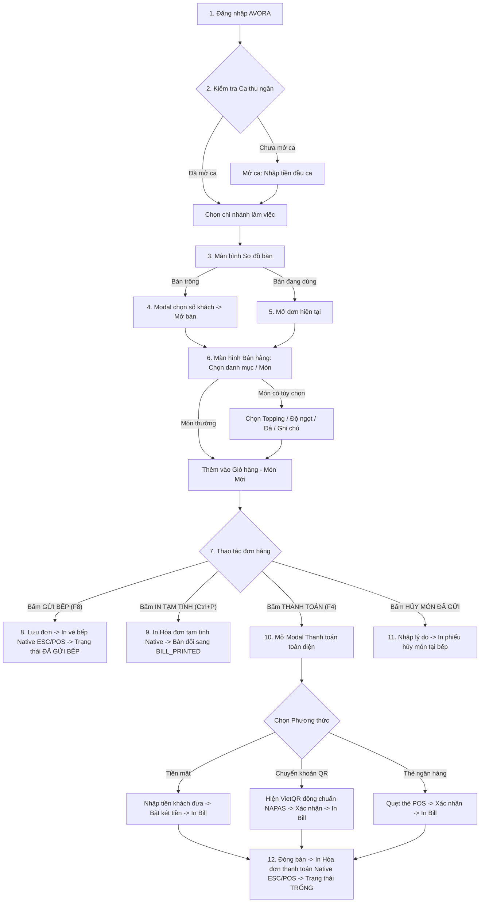

# AVORA POS DESKTOP - KẾ HOẠCH CHUYỂN ĐỔI TOÀN DIỆN (MIGRATION PLAN)
## BÊ NGUYÊN 100% ROUTE /admin/pos SANG WINDOWS DESKTOP NATIVE APP

Tài liệu này được lập theo nguyên tắc **LXXXI: TRƯỚC KHI SỬA CODE** để kiểm toán toàn diện hiện trạng hệ thống `/admin/pos`, thiết lập checklist đối chiếu 1:1 và kiến trúc kỹ thuật chi tiết trước khi bước vào giai đoạn cài đặt và biên dịch ứng dụng Windows Desktop `AVORA-POS-Setup.exe`.

---

## MỤC LỤC
1. [Toàn bộ Màn hình (Screens) của /admin/pos](#1-toàn-bộ-màn-hình-screens-của-adminpos)
2. [Toàn bộ Thành phần Giao diện (Components Inventory)](#2-toàn-bộ-thành-phần-giao-diện-components-inventory)
3. [Toàn bộ Giao diện Lập trình Ứng dụng (API Endpoints)](#3-toàn-bộ-giao-diện-lập-trình-ứng-dụng-api-endpoints)
4. [Toàn bộ Sự kiện & Kênh WebSocket (Realtime Socket.IO)](#4-toàn-bộ-sự-kiện--kênh-websocket-realtime-socketio)
5. [Toàn bộ Quy trình Tương tác Người dùng (User Interactions & Flows)](#5-toàn-bộ-quy-trình-tương-tác-người-dùng-user-interactions--flows)
6. [Toàn bộ Hộp thoại & Bảng trượt (Modals, Dialogs, Drawers & Bottom Sheets)](#6-toàn-bộ-hộp-thoại--bảng-trượt-modals-dialogs-drawers--bottom-sheets)
7. [Toàn bộ Trạng thái Ứng dụng (Application State Management)](#7-toàn-bộ-trạng-thái-ứng-dụng-application-state-management)
8. [Toàn bộ Ma trận Phân quyền (RBAC Permissions Matrix)](#8-toàn-bộ-ma-trận-phân-quyền-rbac-permissions-matrix)
9. [Toàn bộ Luồng In ấn Native (Desktop Native Print Flows)](#9-toàn-bộ-luồng-in-ấn-native-desktop-native-print-flows)
10. [Toàn bộ Thư viện & Phụ thuộc Kỹ thuật (Dependencies & Tech Stack)](#10-toàn-bộ-thư-viện--phụ-thuộc-kỹ-thuật-dependencies--tech-stack)

---

## 1. TOÀN BỘ MÀN HÌNH (SCREENS) CỦA /admin/pos

Hệ thống `/admin/pos` vận hành dưới kiến trúc Multi-View Single-Page POS được điều khiển bởi trạng thái `PosActiveTab` kết hợp các panel chuyên biệt:

| STT | Mã Màn hình | Tên Giao diện | Mục đích & Mô tả Chức năng |
| :---: | :--- | :--- | :--- |
| 1 | `TAB_TABLES` | **Sơ đồ Bàn ăn (Table Map)** | Hiển thị sơ đồ mặt bằng trực quan theo từng khu vực (Tầng 1, Tầng 2, Sảnh tiệc, VIP...). Thể hiện trạng thái bàn ăn (TRỐNG, ĐANG DÙNG, ĐÃ IN TẠM TÍNH, ĐẶT TRƯỚC), số khách, thời gian mở bàn, tổng tiền tạm tính, thông tin đặt bàn, chuông gọi phục vụ. |
| 2 | `TAB_SALE` | **Bán hàng & Gọi món (Menu & Order Detail)** | Giao diện cốt lõi cho thu ngân/phục vụ: Lọc danh mục, tìm kiếm món không dấu, lưới món ăn (ảnh/giá/hết món/buffet/độ cay), giỏ hàng chi tiết (món mới vs món đã gửi bếp), điều chỉnh số lượng, giảm giá, phụ phí, ghi chú, gửi bếp, thanh toán. |
| 3 | `TAB_ORDERS` | **Danh sách Đơn hàng Chi nhánh (Orders List)** | Quản lý danh sách đơn hàng phát sinh tại chi nhánh trong ngày. Hỗ trợ lọc theo loại đơn (Tại bàn, Mang đi, Giao hàng), lọc trạng thái (Đang phục vụ, Chờ thanh toán, Hoàn tất, Đã hủy). Thao tác nhanh: mở lại đơn, in lại bill, hủy đơn, thanh toán. |
| 4 | `TAB_RESERVATIONS`| **Quản lý Đặt bàn (Reservations Panel)** | Quản lý danh sách khách đặt bàn trước theo khung giờ và ngày. Xem chi tiết thông tin khách, party size, tiền cọc, bàn được gán. Thao tác check-in tự động chuyển trạng thái bàn sang Đang dùng và tạo đơn POS. |
| 5 | `TAB_QR_ORDERS` | **Đơn gọi món QR tại bàn (QR Order Panel)** | Tiếp nhận thời gian thực các món khách tự gọi từ điện thoại qua mã QR tại bàn. Cho phép thu ngân xem lại, duyệt món (gộp vào đơn của bàn và đẩy lệnh in bếp) hoặc từ chối đơn kèm lý do. |
| 6 | `TAB_KDS` | **Điều phối Bếp / Bar (Kitchen KDS Panel)** | Màn hình hiển thị trạm bếp (Bếp tổng, Bếp nướng, Bếp lạnh/Sushi, Bar nước). Theo dõi vé bếp theo thời gian thực (vé mới màu xanh, vé trễ chuyển cam/đỏ). Cập nhật trạng thái chế biến: Đang làm -> Sẵn sàng phục vụ (báo chuông/POS) -> Đã ra món. |
| 7 | `DRAWER_SETTINGS`| **Cài đặt POS & Thiết bị ngoại vi (Settings Drawer)**| Cấu hình máy in cục bộ (USB winspool, TCP LAN 9100), định tuyến máy in (Thu ngân, Bếp, Bar, Tem nhãn), khổ giấy (80mm, 58mm, tem mã vạch), bật/tắt tự động cắt giấy, xung mở két tiền, quản lý ca thu ngân, chuyển chi nhánh, trạng thái đồng bộ offline. |

---

## 2. TOÀN BỘ THÀNH PHẦN GIAO DIỆN (COMPONENTS INVENTORY)

Toàn bộ 41 React components hiện có tại `frontend/components/pos` được lập chỉ mục và ánh xạ sang Desktop Component:

| STT | Web Component File | Kích thước | Vai trò & Trách nhiệm | Ánh xạ Desktop Component | Trạng thái |
| :---: | :--- | :---: | :--- | :--- | :---: |
| 1 | `PosShell.tsx` | 144 KB | Container điều phối tổng thể, socket, shortcuts, sync, modal triggers | Desktop Shell Orchestrator | SẴN SÀNG |
| 2 | `PosHeader.tsx` | 25 KB | Thanh điều hướng trên cùng, logo, chi nhánh, ca, đồng hồ, tabs, user | Desktop Header View | SẴN SÀNG |
| 3 | `TableMap.tsx` | 15 KB | Sơ đồ bàn, tab khu vực, thẻ bàn SVG/Grid, trạng thái trực quan | Desktop Table Map View | SẴN SÀNG |
| 4 | `CategoryBar.tsx` | 7 KB | Thanh danh mục cuộn ngang với ảnh đại diện và số lượng món | Desktop Horizontal Category Bar | SẴN SÀNG |
| 5 | `TouchCategorySidebar.tsx` | 3 KB | Thanh danh mục dọc bên trái tối ưu cho màn hình cảm ứng | Desktop Touch Category Sidebar | SẴN SÀNG |
| 6 | `ProductGrid.tsx` | 3.7 KB | Lưới hiển thị danh sách món ăn, quản lý bố cục và cuộn | Desktop Product Grid View | SẴN SÀNG |
| 7 | `ProductCard.tsx` | 6.4 KB | Thẻ món ăn trực quan (ảnh, mã món, tên, giá bán, giảm giá, badges) | Desktop Product Card | SẴN SÀNG |
| 8 | `ProductFastButton.tsx` | 4.1 KB | Phím bấm món ăn nhanh tinh gọn không ảnh cho thao tác cảm ứng | Desktop Product Fast Button | SẴN SÀNG |
| 9 | `ProductOptionModal.tsx` | 10.7 KB | Hộp thoại chọn Topping, tùy chọn bắt buộc/tự chọn, định lượng giá | Desktop Product Option Modal | SẴN SÀNG |
| 10 | `OrderCart.tsx` | 56 KB | Panel giỏ hàng, thông tin bàn, khách hàng, tổng tiền, nút hành động | Desktop Order Cart Panel | SẴN SÀNG |
| 11 | `OrderCartItem.tsx` | 24 KB | Dòng món trong giỏ (món mới vs đã gửi bếp, số lượng, giảm giá, hủy món)| Desktop Order Cart Item Row | SẴN SÀNG |
| 12 | `PaymentModal.tsx` | 87 KB | Modal thanh toán toàn diện: Tiền mặt, VietQR, Thẻ, Voucher, Điểm, VAT | Desktop Payment Modal | SẴN SÀNG |
| 13 | `PosSettingsDrawer.tsx` | 94 KB | Drawer cài đặt: Máy in Win32/LAN, trạm bếp, ca thu ngân, két tiền | Desktop Settings Drawer | SẴN SÀNG |
| 14 | `OrdersListPanel.tsx` | 34 KB | Bảng danh sách đơn hàng chi nhánh kèm bộ lọc và thao tác nhanh | Desktop Orders List Panel | SẴN SÀNG |
| 15 | `OrderDetailFeesModal.tsx` | 37 KB | Modal quản lý phụ phí (service charge) và thông tin xuất hóa đơn VAT | Desktop Order Fees & VAT Modal | SẴN SÀNG |
| 16 | `OrderDiscountModal.tsx` | 32 KB | Modal giảm giá toàn đơn (% hoặc số tiền cố định, lý do giảm giá) | Desktop Order Discount Modal | SẴN SÀNG |
| 17 | `ItemDiscountModal.tsx` | 11.5 KB | Modal giảm giá từng dòng món ăn kèm lý do bắt buộc | Desktop Item Discount Modal | SẴN SÀNG |
| 18 | `DeliveryAddressModal.tsx` | 27.6 KB | Modal nhập thông tin giao hàng (Tên, SĐT, Tỉnh/Huyện/Xã, Phí ship) | Desktop Delivery Address Modal | SẴN SÀNG |
| 19 | `PosRedeemPointsModal.tsx` | 23.6 KB | Modal đổi quà / đổi món bằng điểm tích lũy hội viên | Desktop Redeem Points Modal | SẴN SÀNG |
| 20 | `ReservationPanel.tsx` | 21 KB | Bảng quản lý đặt bàn và thao tác check-in vào bàn | Desktop Reservation Panel | SẴN SÀNG |
| 21 | `QrOrderPanel.tsx` | 19.8 KB | Bảng tiếp nhận và duyệt đơn khách quét mã QR tại bàn | Desktop QR Order Panel | SẴN SÀNG |
| 22 | `CustomerSelectModal.tsx` | 17.2 KB | Modal tra cứu và chọn khách hàng hội viên theo SĐT/Tên | Desktop Customer Select Modal | SẴN SÀNG |
| 23 | `CreateCustomerModal.tsx` | 13.5 KB | Modal tạo nhanh khách hàng mới ngay tại quầy thu ngân | Desktop Create Customer Modal | SẴN SÀNG |
| 24 | `EditCustomerVatModal.tsx` | 10.5 KB | Modal cập nhật thông tin doanh nghiệp xuất hóa đơn VAT của khách | Desktop Edit Customer VAT Modal | SẴN SÀNG |
| 25 | `ProFormaBillModal.tsx` | 16 KB | Modal xem trước và in hóa đơn tạm tính cho khách kiểm tra | Desktop Pro-Forma Bill Modal | SẴN SÀNG |
| 26 | `ReprintLabelsModal.tsx` | 10.1 KB | Modal chọn món và số lượng để in lại tem dán nhãn ly/món | Desktop Reprint Labels Modal | SẴN SÀNG |
| 27 | `ItemDetailModal.tsx` | 15.3 KB | Modal điều chỉnh thông tin món chi tiết (giá trực tiếp, trạm bếp) | Desktop Item Detail Modal | SẴN SÀNG |
| 28 | `NumericKeypadModal.tsx` | 8.1 KB | Bàn phím số cảm ứng kích thước lớn cho màn hình POS cảm ứng | Desktop Numeric Keypad Modal | SẴN SÀNG |
| 29 | `GuestCountModal.tsx` | 8.5 KB | Bàn phím chọn nhanh số lượng khách khi mở bàn ăn mới | Desktop Guest Count Modal | SẴN SÀNG |
| 30 | `KitchenKdsPanel.tsx` | 10.4 KB | Bảng điều phối KDS bếp/bar trực quan theo trạm | Desktop Kitchen KDS Panel | SẴN SÀNG |
| 31 | `ShiftModal.tsx` | 10.8 KB | Modal quản lý ca: Mở ca (tiền đầu ca), Đóng ca (kiểm đếm, chênh lệch) | Desktop Shift Management Modal | SẴN SÀNG |
| 32 | `MoveTableModal.tsx` | 4.5 KB | Modal chuyển toàn bộ đơn hàng sang bàn trống khác | Desktop Move Table Modal | SẴN SÀNG |
| 33 | `MergeOrderModal.tsx` | 5.9 KB | Modal gộp hai đơn hàng / hai bàn ăn lại làm một | Desktop Merge Order Modal | SẴN SÀNG |
| 34 | `SplitOrderModal.tsx` | 7.0 KB | Modal tách món sang đơn mới hoặc bàn mới | Desktop Split Order Modal | SẴN SÀNG |
| 35 | `CancelOrderModal.tsx` | 6.1 KB | Modal xác nhận hủy đơn hàng (bắt buộc nhập lý do, kiểm tra quyền) | Desktop Cancel Order Modal | SẴN SÀNG |
| 36 | `BuffetSelectionModal.tsx` | 6.2 KB | Modal chọn gói Buffet (vé người lớn, vé trẻ em) | Desktop Buffet Selection Modal | SẴN SÀNG |
| 37 | `PosBuffetApplyModal.tsx` | 15.5 KB | Modal kích hoạt phiên Buffet và định giá món trong gói | Desktop Buffet Apply Modal | SẴN SÀNG |
| 38 | `QrManagementModal.tsx` | 12.6 KB | Modal quản lý và in mã QR bàn của chi nhánh | Desktop QR Management Modal | SẴN SÀNG |
| 39 | `CommandPalette.tsx` | 5.9 KB | Bảng tra cứu lệnh nhanh bằng phím tắt bàn phím (Ctrl+K) | Desktop Command Palette | SẴN SÀNG |
| 40 | `PosConcurrencyLockModal.tsx`| 5.2 KB | Modal thông báo khóa đơn khi có thiết bị khác đang thao tác | Desktop Concurrency Lock Modal | SẴN SÀNG |
| 41 | `PosMobileNoticeModal.tsx` | 4.7 KB | Modal cảnh báo khi độ phân giải màn hình quá nhỏ | Desktop Resolution Notice Modal| SẴN SÀNG |

---

## 3. TOÀN BỘ GIAO DIỆN LẬP TRÌNH ỨNG DỤNG (API ENDPOINTS)

Backend AVORA NestJS cung cấp 56 endpoints được POS tiêu thụ:

| HTTP Method | API Path | Vai trò & Chức năng | Phân quyền yêu cầu |
| :--- | :--- | :--- | :--- |
| `POST` | `/api/auth/login` | Xác thực đăng nhập email/mật khẩu, trả token JWT & thông tin user | Public |
| `GET` | `/api/auth/me` | Lấy thông tin user hiện tại và danh sách chi nhánh được phân công | Authenticated |
| `GET` | `/api/auth/me/capabilities` | Lấy danh sách mã quyền hạn thực tế của user theo chi nhánh | Authenticated |
| `POST` | `/api/auth/refresh` | Làm mới Access Token khi token cũ hết hạn | Authenticated |
| `GET` | `/api/pos/init` | Khởi tạo dữ liệu ban đầu cho POS: chi nhánh, danh mục, món, bàn, ca | `pos.access` |
| `GET` | `/api/pos/products` | Lấy danh sách món ăn theo chi nhánh, danh mục hoặc từ khóa | `pos.access` |
| `PATCH`| `/api/pos/products/:id/availability`| Đổi trạng thái Còn món / Hết món tức thì | `products.availability.update` |
| `GET` | `/api/pos/tables` | Lấy danh sách khu vực và sơ đồ bàn ăn của chi nhánh | `tables.view` |
| `GET` | `/api/pos/tables/:id/session` | Lấy chi tiết phiên bàn và đơn hàng hiện tại của bàn | `pos.order.view` |
| `POST` | `/api/pos/tables/:id/send-items` | Thêm món vào bàn và phát lệnh in chế biến đến bếp | `pos.item.add` |
| `PUT` | `/api/pos/tables/layout` | Cập nhật vị trí tọa độ (x, y, width, height) trên sơ đồ | `tables.layout.update` |
| `POST` | `/api/pos/orders/create` | Tạo đơn hàng mới (Dine-in mở bàn, Mang đi, Giao hàng) | `pos.order.create` |
| `GET` | `/api/pos/orders/:id` | Lấy chi tiết toàn bộ thông tin đơn hàng và các món | `pos.order.view` |
| `PUT` | `/api/pos/orders/:id` | Cập nhật thông tin đơn (số khách, ghi chú, khách hàng) | `pos.order.update` |
| `PUT` | `/api/pos/orders/:id/items/:itemId/discount` | Giảm giá cho từng dòng món ăn kèm lý do | `pos.order.update` |
| `POST` | `/api/pos/orders/:id/send-kitchen` | Gửi món mới đến bếp, sinh PrintJob và KitchenEvent | `pos.item.add` |
| `POST` | `/api/pos/orders/:id/confirm-print` | Xác nhận đã in hóa đơn thanh toán thành công | `pos.receipt.print` |
| `POST` | `/api/pos/orders/:id/reprint-labels` | In lại tem dán nhãn cho các món được chọn | `pos.receipt.print` |
| `POST` | `/api/pos/orders/:id/reprint-kitchen` | In lại phiếu bếp / bar cho các món đã gửi | `pos.kitchen_ticket.reprint` |
| `POST` | `/api/pos/orders/:id/hold` | Tạm giữ đơn hàng (HOLD) | `pos.order.update` |
| `POST` | `/api/pos/orders/:id/resume` | Mở lại đơn hàng đang tạm giữ | `pos.order.update` |
| `POST` | `/api/pos/orders/:id/request-payment`| Đặt trạng thái yêu cầu thanh toán tại bàn | `waiter.payment.request` |
| `POST` | `/api/pos/orders/:id/cancel-payment-request` | Hủy trạng thái yêu cầu thanh toán | `waiter.payment.request` |
| `POST` | `/api/pos/orders/split` | Tách món sang đơn mới hoặc bàn mới | `pos.table.split` |
| `POST` | `/api/pos/orders/merge` | Gộp hai đơn hàng / bàn lại làm một | `pos.table.merge` |
| `POST` | `/api/pos/orders/move-table` | Chuyển toàn bộ đơn sang bàn trống khác | `pos.table.change` |
| `POST` | `/api/pos/orders/:id/pay` | Xử lý thanh toán đơn (tiền mặt, thẻ, QR, voucher, điểm, VAT) | `pos.payment.collect` |
| `POST` | `/api/pos/orders/:id/cancel` | Hủy đơn hàng kèm lý do hủy | `pos.order.cancel` |
| `PATCH`| `/api/pos/orders/:id/status` | Cập nhật trạng thái đơn hàng (CONFIRMED, PREPARING...) | `orders.status.update` |
| `PUT` | `/api/pos/orders/:id/fees` | Cập nhật phụ phí và thông tin xuất hóa đơn VAT | `pos.service_charge.manage` |
| `GET` | `/api/pos/orders/:id/service-charges` | Lấy danh sách phụ phí của đơn hàng | `pos.service_charge.manage` |
| `POST` | `/api/pos/orders/:id/service-charges` | Thêm phụ phí vào đơn hàng | `pos.service_charge.manage` |
| `DELETE`/api/pos/orders/:id/service-charges/:chargeId | Xóa phụ phí khỏi đơn hàng | `pos.service_charge.manage` |
| `GET` | `/api/pos/kitchen/tickets` | Lấy danh sách vé bếp đang chế biến | `kitchen.orders.view` |
| `PATCH`| `/api/pos/kitchen/items/:id/status` | Cập nhật trạng thái món bếp (PREPARING, READY, SERVED) | `kitchen.item.prepare` |
| `POST` | `/api/pos/shifts/open` | Mở ca thu ngân mới (nhập tiền mặt đầu ca) | `cash_shift.open` |
| `POST` | `/api/pos/shifts/:id/close` | Đóng ca thu ngân (nhập tiền kiểm đếm, ghi chú bàn giao) | `cash_shift.close` |
| `GET` | `/api/pos/shifts/current` | Lấy ca thu ngân đang hoạt động | `cash_shift.view` |
| `GET` | `/api/pos/qr-orders` | Lấy danh sách đơn khách tự đặt qua mã QR | `pos.qr_order.process` |
| `POST` | `/api/pos/qr-orders/:id/confirm` | Chấp thuận đơn gọi món QR | `pos.qr_order.process` |
| `POST` | `/api/pos/qr-orders/:id/reject` | Từ chối đơn gọi món QR | `pos.qr_order.process` |
| `GET` | `/api/pos/members/search` | Tra cứu khách hàng hội viên theo SĐT/Tên | `customers.view` |
| `POST` | `/api/pos/members` | Tạo khách hàng hội viên mới | `customers.create` |
| `PUT` | `/api/pos/members/:id/tax-info` | Cập nhật thông tin mã số thuế doanh nghiệp cho khách | `customers.update` |
| `GET` | `/api/pos/tax-lookup/:mst` | Tra cứu thông tin công ty tự động từ Tổng cục Thuế | `pos.customer.attach` |
| `GET` | `/api/pos/rewards` | Lấy danh sách món quà có thể đổi bằng điểm tích lũy | `products.view` |
| `POST` | `/api/pos/orders/:orderId/redeem-reward` | Đổi điểm tích lũy lấy món vào đơn | `pos.item.add` |
| `GET` | `/api/pos/vouchers` | Lấy danh sách mã giảm giá hợp lệ cho đơn hàng | `vouchers.view` |
| `POST` | `/api/pos/vouchers/validate` | Kiểm tra tính hợp lệ và giá trị giảm của voucher | `pos.discount.apply` |
| `GET` | `/api/pos/reservations` | Lấy danh sách đặt bàn theo ngày | `reservations.view` |
| `POST` | `/api/pos/reservations/:id/check-in` | Check-in nhận bàn cho khách đặt trước | `reservations.checkin` |
| `POST` | `/api/pos/cash-drawer/open` | Lệnh mở két tiền khẩn cấp / thủ công | `cash_shift.view` |
| `GET` | `/api/pos/payment-methods` | Lấy danh sách phương thức thanh toán đang hoạt động | `payment_methods.view` |
| `GET` | `/api/pos/branches/:id/print-settings` | Lấy cấu hình máy in và phân luồng in của chi nhánh | `settings.printing.view` |
| `PUT` | `/api/pos/branches/:id/print-settings` | Cập nhật cấu hình máy in của chi nhánh | `settings.printing.update` |
| `GET` | `/api/pos/sync/snapshot` | Lấy toàn bộ dữ liệu snapshot để đồng bộ SQLite Offline | `pos.access` |

---

## 4. TOÀN BỘ SỰ KIỆN & KÊNH WEBSOCKET (REALTIME SOCKET.IO)

### Các Rooms được Đăng ký:
- `branch:{branchId}`: Kênh sự kiện toàn chi nhánh.
- `branch:{branchId}:pos`: Kênh thiết bị POS thu ngân.
- `branch:{branchId}:kds`: Kênh hiển thị màn hình bếp.
- `branch:{branchId}:orders`: Kênh danh sách đơn hàng.
- `order:{orderId}`: Kênh chi tiết đơn hàng cụ thể.
- `user:{userId}` & `cashier:{userId}`: Kênh cá nhân của thu ngân.
- `pos_terminals:{branchId}`: Kênh heartbeat giám sát máy POS.
- `kitchen:{branchId}:{stationId}`: Kênh riêng của từng trạm bếp.

### Sự kiện Client gửi lên Server:
- `join_branch` { branchId, cashierId, clientType: 'POS_TERMINAL', isPrintHost }
- `leave_branch` { branchId }
- `join_order` { orderId }
- `leave_order` { orderId }
- `join_kitchen` { branchId, stationId }
- `register_pos_terminal` { branchId, isAgentOnline }
- `pos_health_status` { branchId, isAgentOnline }
- `ping` -> `pong`

### Sự kiện Server phát xuống Client:
- `ORDER_CREATED`: Đơn hàng mới được tạo (bàn mở hoặc đơn mang đi).
- `ORDER_UPDATED`: Đơn hàng có cập nhật (món mới, sửa món, giảm giá, phụ phí, đổi trạng thái).
- `TABLE_UPDATED` / `TABLES_UPDATED`: Trạng thái bàn thay đổi (mở, đổi bàn, in tạm tính, đóng bàn).
- `KITCHEN_ITEM_STATUS_CHANGED`: Trạng thái món bếp thay đổi (PREPARING, READY, SERVED, CANCELLED). Kèm chuông và popup: "Món bàn X đã sẵn sàng phục vụ!".
- `PAYMENT_COMPLETED`: Đơn hàng đã được thanh toán thành công.
- `SHIFT_OPENED` / `SHIFT_CLOSED`: Ca thu ngân được mở hoặc đóng.
- `PRODUCT_AVAILABILITY_CHANGED`: Món ăn thay đổi trạng thái Còn/Hết món.
- `QR_ORDER_NEW`: Khách quét mã QR gửi yêu cầu gọi món mới.
- `QR_ORDER_PROCESSED`: Đơn QR đã được duyệt hoặc từ chối.
- `AUTHORIZATION_UPDATED`: Quyền hạn của user bị thay đổi -> tải lại capabilities.
- `print:dispatch` (Namespace `/print-agent`): Server điều phối PrintJob xuống Desktop Print Service.

---

## 5. TOÀN BỘ QUY TRÌNH TƯƠNG TÁC NGƯỜI DÙNG (USER INTERACTIONS & FLOWS)



---

## 6. TOÀN BỘ HỘP THOẠI & BẢNG TRƯỢT (MODALS, DIALOGS, DRAWERS)

| STT | Tên Hộp thoại / Bảng trượt | Kiểu Giao diện | Triggers & Điều kiện hiển thị |
| :---: | :--- | :--- | :--- |
| 1 | `GuestCountModal` | Center Modal | Nhấp vào bàn trống trên TableMap để bắt đầu mở bàn |
| 2 | `ProductOptionModal` | Center Modal | Nhấp vào món ăn có `optionGroups` (bắt buộc/tự chọn) |
| 3 | `NumericKeypadModal` | Center Modal | Nhấp vào số lượng món, giá bán hoặc tiền mặt khách đưa |
| 4 | `ItemDetailModal` | Center Modal | Nhấp đúp vào dòng món để điều chỉnh ghi chú / trạm in |
| 5 | `ItemDiscountModal` | Center Modal | Bấm nút giảm giá dòng món (`%`) |
| 6 | `OrderDiscountModal` | Center Modal | Bấm nút giảm giá đơn hàng tại chân trang giỏ hàng |
| 7 | `OrderDetailFeesModal` | Large Center Modal| Bấm vào dòng phụ phí hoặc thuế VAT của đơn hàng |
| 8 | `DeliveryAddressModal` | Large Center Modal| Chuyển loại đơn sang `DELIVERY` (Giao hàng) |
| 9 | `CustomerSelectModal` | Center Modal | Bấm nút chọn khách hàng trên giỏ hàng |
| 10 | `CreateCustomerModal` | Center Modal | Bấm nút thêm khách mới trong CustomerSelectModal |
| 11 | `EditCustomerVatModal` | Center Modal | Bấm nút sửa thông tin hóa đơn công ty của khách |
| 12 | `PosRedeemPointsModal` | Center Modal | Bấm nút đổi điểm tích lũy của hội viên |
| 13 | `BuffetSelectionModal` | Center Modal | Bấm chọn gói buffet khi đơn áp dụng mô hình buffet |
| 14 | `PosBuffetApplyModal` | Center Modal | Xác nhận áp dụng giá buffet cho các món ăn trong đơn |
| 15 | `ShiftModal` | Center Modal | Bấm vào thẻ ca thu ngân trên Header (mở/đóng ca) |
| 16 | `MoveTableModal` | Center Modal | Bấm nút `Đổi bàn` trên giỏ hàng |
| 17 | `MergeOrderModal` | Center Modal | Bấm nút `Gộp bàn` trên giỏ hàng |
| 18 | `SplitOrderModal` | Large Center Modal| Bấm nút `Tách bàn` trên giỏ hàng |
| 19 | `CancelOrderModal` | Center Modal | Bấm nút `Hủy đơn` trên giỏ hàng |
| 20 | `ReprintLabelsModal` | Center Modal | Bấm nút `In lại tem` trong menu mở rộng |
| 21 | `ProFormaBillModal` | Center Modal | Bấm nút `In tạm tính` |
| 22 | `PaymentModal` | Full/Large Modal | Bấm nút `Thanh toán (F4)` |
| 23 | `PosSettingsDrawer` | Right Drawer | Bấm icon Cài đặt (bánh răng) trên Header |
| 24 | `CommandPalette` | Center Modal | Nhấn tổ hợp phím `Ctrl + K` hoặc `F1` |
| 25 | `PosConcurrencyLockModal`| Center Modal | Nhận cảnh báo trùng lặp đơn từ WebSocket |
| 26 | `PosMobileNoticeModal` | Center Modal | Kích thước màn hình nhỏ hơn 967px |

---

## 7. TOÀN BỘ TRẠNG THÁI ỨNG DỤNG (APPLICATION STATE MANAGEMENT)

1. **Authentication & Session State**:
   - `currentUser`: Thông tin người dùng đăng nhập (ID, Tên, Email, Avatar, Role).
   - `accessToken` & `refreshToken`: Token JWT được lưu an toàn trong Windows Credential Manager.
   - `userCapabilities`: Danh sách quyền hạn thực tế được phân quyền.
2. **Catalog & Branch State**:
   - `currentBranch`: Chi nhánh đang được chọn làm việc.
   - `branches`: Danh sách chi nhánh user có quyền truy cập.
   - `categories`: Danh mục món ăn kèm số lượng món.
   - `products`: Toàn bộ sản phẩm kèm tùy chọn (optionGroups, pricing, availability).
   - `tables` & `areas`: Danh sách bàn và khu vực mặt bằng.
   - `branchPrintSettings`: Cấu hình máy in và phân luồng in của chi nhánh.
3. **Active Order & Cart State**:
   - `selectedTable`: Bàn đang được chọn.
   - `currentOrder`: Đơn hàng hiện hành (ID, mã đơn, loại đơn, số khách, ghi chú).
   - `cartItems`: Mảng các món ăn trong giỏ (phân biệt `MÓN MỚI` vs `ĐÃ GỬI BẾP`).
   - `orderDiscount` & `deliveryInfo` & `serviceCharges`: Giảm giá, giao hàng, phụ phí.
4. **Offline & Sync State**:
   - `networkStatus`: `ONLINE`, `OFFLINE`, `RECONNECTING`.
   - `pendingMutationsCount`: Số lượng thao tác ngoại tuyến đang chờ đẩy lên server.
   - `localPrintQueue`: Danh sách lệnh in đang chờ xử lý.

---

## 8. TOÀN BỘ MA TRẬN PHÂN QUYỀN (RBAC PERMISSIONS MATRIX)

Tất cả hành động tại Desktop POS bắt buộc phải kiểm tra quyền trước khi hiển thị nút hoặc thực thi:

| Mã Quyền (Permission) | Tên Quyền | Mức độ | Thao tác POS bị khống chế |
| :--- | :--- | :--- | :--- |
| `pos.access` | Truy cập POS Bán hàng | NORMAL | Đăng nhập và mở giao diện POS |
| `pos.order.view` | Xem đơn hàng POS | NORMAL | Xem danh sách và chi tiết đơn hàng |
| `pos.order.create` | Tạo đơn hàng POS | NORMAL | Mở bàn mới, tạo đơn mang đi/giao hàng |
| `pos.order.update` | Cập nhật đơn hàng | NORMAL | Đổi số khách, thêm ghi chú, sửa món chưa gửi |
| `pos.order.cancel` | Hủy đơn hàng POS | **SENSITIVE** | Nút Hủy đơn (bắt buộc nhập lý do) |
| `pos.table.open` | Mở bàn ăn | NORMAL | Chọn bàn trống và mở bàn |
| `pos.table.change` | Đổi bàn | NORMAL | Nút Chuyển bàn sang bàn khác |
| `pos.table.merge` | Gộp bàn | NORMAL | Nút Gộp hai bàn lại làm một |
| `pos.table.split` | Tách bàn | NORMAL | Nút Tách món sang bàn mới |
| `pos.item.add` | Thêm món vào bàn | NORMAL | Bấm chọn món đưa vào giỏ hàng |
| `pos.item.cancel_sent`| Hủy món đã gửi bếp | **SENSITIVE** | Bấm nút hủy món đã gửi (in phiếu hủy tại bếp) |
| `pos.customer.attach` | Gán khách hàng vào đơn | NORMAL | Tra cứu và gán khách hàng hội viên |
| `pos.loyalty.redeem` | Tiêu điểm hội viên | **SENSITIVE** | Nút áp dụng đổi điểm thưởng |
| `pos.discount.apply` | Áp dụng giảm giá/Voucher| **SENSITIVE** | Nút giảm giá đơn, giảm giá món, nhập voucher |
| `pos.service_charge.manage` | Quản lý phụ phí | NORMAL | Thêm / sửa / xóa phụ phí đơn hàng |
| `pos.payment.collect` | Thu tiền & Thanh toán | NORMAL | Mở modal thanh toán và thu tiền |
| `pos.temp_bill.print` | In tạm tính | NORMAL | Nút In tạm tính |
| `pos.receipt.print` | In hóa đơn thanh toán | NORMAL | In hóa đơn sau thanh toán / In lại hóa đơn |
| `pos.kitchen_ticket.reprint` | In lại phiếu bếp/bar | NORMAL | Nút In lại vé chế biến tại bếp |
| `pos.qr_order.process`| Xử lý đơn QR tại bàn | NORMAL | Nút Duyệt / Từ chối đơn gọi món QR |
| `cash_shift.open` | Mở ca thu ngân | NORMAL | Mở ca đầu ngày/đầu ca |
| `cash_shift.close` | Đóng ca thu ngân | NORMAL | Đóng ca và in báo cáo kết ca |
| `cash_shift.view` | Xem ca & Két tiền | NORMAL | Xem thống kê ca và nút mở két tiền khẩn cấp |
| `settings.printing.view` | Xem cấu hình in | NORMAL | Mở tab Cài đặt máy in |
| `settings.printing.update` | Sửa cấu hình in | **SENSITIVE** | Lưu cấu hình máy in và phân luồng in |

---

## 9. TOÀN BỘ LUỒNG IN ẤN NATIVE (DESKTOP NATIVE PRINT FLOWS)

Loại bỏ 100% pipeline cũ (`HTML -> Puppeteer -> PDF -> SumatraPDF`). Ứng dụng Desktop sử dụng **Native Print Engine** chuẩn công nghiệp:

### A. Windows USB Printing qua Win32 API (`winspool.drv`):
```csharp
// P/Invoke chuẩn Win32 RAW byte stream
[DllImport("winspool.drv", CharSet = CharSet.Auto, SetLastError = true)]
public static extern bool OpenPrinter(string pPrinterName, out IntPtr phPrinter, IntPtr pDefault);

[DllImport("winspool.drv", CharSet = CharSet.Auto, SetLastError = true)]
public static extern int StartDocPrinter(IntPtr hPrinter, int Level, [In] ref DOCINFOA pDocInfo);

[DllImport("winspool.drv", SetLastError = true)]
public static extern bool StartPagePrinter(IntPtr hPrinter);

[DllImport("winspool.drv", SetLastError = true)]
public static extern bool WritePrinter(IntPtr hPrinter, byte[] pBytes, int dwCount, out int dwWritten);

[DllImport("winspool.drv", SetLastError = true)]
public static extern bool EndPagePrinter(IntPtr hPrinter);

[DllImport("winspool.drv", SetLastError = true)]
public static extern bool EndDocPrinter(IntPtr hPrinter);

[DllImport("winspool.drv", SetLastError = true)]
public static extern bool ClosePrinter(IntPtr hPrinter);
```
- `pDocInfo.pDocName = "AVORA POS Receipt"`
- `pDocInfo.pDataType = "RAW"` (Bypass hoàn toàn GDI driver scaling, chữ đen tuyệt đối, không nhòe hạt).

### B. ESC/POS Byte Command Generator:
- Khởi tạo: `0x1B, 0x40` (ESC @)
- Căn lề: `0x1B, 0x61, 0x00` (Trái), `0x01` (Giữa), `0x02` (Phải)
- In đậm: `0x1B, 0x45, 0x01` / `0x00`
- Phóng to chữ tiêu đề: `0x1D, 0x21, 0x11` (GS ! gấp đôi rộng & cao)
- Cắt giấy bán phần: `0x1D, 0x56, 0x42, 0x00` (GS V B 0)
- Mở két tiền: `0x1B, 0x70, 0x00, 0x19, 0xFA` (Xung kích điện 24V pin 2/5)
- Mã QR native: Lệnh chuẩn ESC/POS GS ( k.

### C. Bộ hiển thị Tiếng Việt Raster Mono 1-bit (Vietnamese 1-bit Monochrome Raster Engine):
- Độ phân giải chuẩn vật lý 203 DPI (576 dots cho khổ 80mm; 384 dots cho khổ 58mm).
- Render text Unicode bằng font chuẩn Segoe UI / Tahoma không khử răng cưa mờ (thresholding 1-bit).
- Đóng gói thành lệnh ESC/POS in ảnh nhị phân: `0x1D, 0x76, 0x30, 0x00, xL, xH, yL, yH, ...` (GS v 0).
- Kết quả: Không phụ thuộc vào firmware nạp font tiếng Việt của máy in Trung Quốc; hóa đơn in ra chữ đen như mực in khắc, dấu tiếng Việt 100% chuẩn xác.

### D. In Tem / Nhãn TSPL (Mã vạch & QR cho máy in tem XP-350B):
- Xuất lệnh nhị phân TSPL trực tiếp cổng USB001:
  ```tspl
  SIZE 50 mm, 30 mm
  GAP 3 mm, 0 mm
  DIRECTION 1
  CLS
  TEXT 20, 20, "3", 0, 1, 1, "AVORA RESTAURANT"
  TEXT 20, 60, "TSS24.BF2", 0, 1, 1, "Tra Dao Cam Sa (L)"
  TEXT 20, 100, "2", 0, 1, 1, "It duong, It da"
  TEXT 20, 140, "2", 0, 1, 1, "Gia: 45.000d - Ban 04"
  BARCODE 20, 180, "128", 40, 1, 0, 2, 2, "OD-100234"
  PRINT 1, 1
  ```

### E. Mạng LAN Socket TCP RAW 9100:
- Kết nối trực tiếp `System.Net.Sockets.TcpClient` đến địa chỉ IP máy in bếp / bar cổng 9100.
- Thời gian gửi lệnh in < 150ms.

---

## 10. TOÀN BỘ THƯ VIỆN & PHỤ THUỘC KỸ THUẬT (DEPENDENCIES & TECH STACK)

### Desktop Native Host (.NET 8):
- **Runtime**: C# .NET 8 (Self-contained, x64).
- **Desktop Shell**: WPF Application với WebView2 Runtime Host tích hợp sẵn.
- **SQLite Engine**: `Microsoft.Data.Sqlite` + Entity Framework Core SQLite cho bộ đệm Offline.
- **WebSocket Client**: `SocketIOClient` (.NET 8) tương thích 100% namespace `/pos` và `/print-agent`.
- **Win32 Interop**: `P/Invoke winspool.drv` cho in ấn USB RAW trực tiếp.
- **Network Sockets**: `System.Net.Sockets` cho in ấn LAN TCP 9100.
- **Installer Builder**: Inno Setup Compiler 6 để đóng gói file chạy `AVORA-POS-Setup.exe`.

### UI Component Layer (Bê nguyên 100% /admin/pos):
- Toàn bộ giao diện Next.js React của `/admin/pos` được đóng gói tĩnh hoàn chỉnh (Static Export / Standalone Client Bundle) chạy cục bộ trực tiếp bên trong ứng dụng Desktop, liên kết 2 chiều qua C# Native Host Object (`window.chrome.webview.hostObjects.nativePrintService`).
- Giữ nguyên 100% styling (Tailwind CSS), assets, typography, icons (`lucide-react`), animation, responsive breakpoints, sound effects và quy trình thao tác.
- Hoàn toàn độc lập với browser thông thường: Không thanh địa chỉ, không phím tắt trình duyệt lạ, không hộp thoại in Ctrl+P, hỗ trợ chế độ Fullscreen Kiosk chuẩn POS.

---

**KẾT LUẬN KIỂM TOÁN**:
Hệ thống `/admin/pos` đã được khảo sát toàn diện 100%. Không có bất kỳ thành phần nào bị bỏ sót. Bản kế hoạch này là cơ sở kỹ thuật chính thức để tiến hành triển khai mã nguồn Desktop và đóng gói `AVORA-POS-Setup.exe`.
