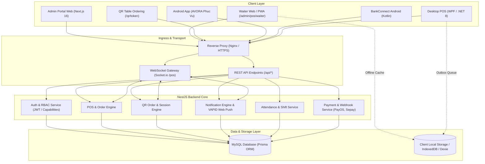

# AVORA Restaurant Management System

> **A multi-module restaurant management system with web-based administration, point-of-sale operations, QR ordering, kitchen workflows, workforce tools, and supporting applications.**

[](https://nextjs.org/)
[](https://react.dev/)
[](https://nestjs.com/)
[](https://www.prisma.io/)
[](https://www.typescriptlang.org/)
[](https://www.mysql.com/)
[](https://dotnet.microsoft.com/)
[](https://developer.android.com/)

---

## Giới thiệu tổng quan (Vietnamese Overview)

**AVORA Restaurant** là hệ thống quản lý nhà hàng đa phân hệ, hỗ trợ vận hành F&B từ khâu gọi món tại bàn, chế biến bếp, thanh toán thu ngân đến quản trị chi nhánh và nhân sự:

- **Cổng Quản trị & Điều hành (`frontend/app/admin`)**: Quản lý thực đơn, danh mục, kho nguyên liệu, đơn hàng, bàn ăn, báo cáo doanh thu, phân quyền RBAC và cấu hình hệ thống.
- **POS Thu ngân & Phục vụ bàn (`/admin/pos` & `/admin/pos/waiter`)**: Giao diện bán hàng thu ngân và ứng dụng phục vụ bàn trên Web PWA và Android WebView.
- **Gọi món QR tại bàn (`/qr/[token]`)**: Khách hàng quét mã QR trên bàn để xem thực đơn, gọi món Alacarte & Buffet theo đợt, gọi nhân viên, yêu cầu thanh toán và gửi thông tin xuất hóa đơn VAT.
- **Bếp & Pha chế (KDS - `/admin/kds`)**: Màn hình điều phối chế biến theo trạm bếp, cập nhật trạng thái món qua WebSocket theo thời gian thực.
- **Chấm công & Ca làm việc (`/admin/attendance`)**: Chấm công qua mã QR xác thực tọa độ GPS (geofencing), cấu hình ca làm việc, bảng công xuất Excel và thẻ chấm công cá nhân.
- **Ứng dụng hỗ trợ**: Ứng dụng Android phục vụ bàn (`android-avora-phuc-vu`) đóng gói bằng native Kotlin WebView container, ứng dụng Android lắng nghe thông báo giao dịch ngân hàng (`android/`), và phần mềm POS Desktop .NET 8 WPF (`desktop/`).

---

## Key Modules & Implementation Status

| Module | Category | Description | Status |
| :--- | :--- | :--- | :---: |
| **Point of Sale (POS)** | Operations | Cashier POS interface supporting cash, bank transfer, PayOS/Sepay webhooks, card, split payments, table merging/splitting, custom item pricing, and weight (kg) decimals. | **Implemented** |
| **Waiter PWA & Mobile Web** | Operations | Mobile web interface (`/admin/pos/waiter`) with table status map, order round management, and Web Push notifications. | **Implemented** |
| **QR Table Ordering** | Operations | Guest table ordering flow (`/qr/[token]`): Alacarte rounds, buffet dish submission limits, staff call requests, payment requests, order cooldown, and VAT invoice submission. | **Implemented** |
| **Kitchen Display System (KDS)** | Operations | Kitchen screen (`/admin/kds`) with station routing, item state updates, alert sounds, and batch dispatching via WebSocket. | **Implemented** |
| **Buffet Management** | Operations | Buffet ticket management with maximum dish quantity limits per single kitchen submission, session countdown timers, and buffet package tier rules. | **Implemented** |
| **Attendance & Shifts** | Workforce | Geofenced QR attendance check-in/out, multi-shift configurations, Excel timesheet export with formulas, and personal employee timecards. | **Implemented** |
| **Role-Based Access Control (RBAC)** | Security | Role permission model with 5 system roles (`ADMIN`, `BRANCH_MANAGER`, `BRANCH_STAFF`, `BRANCH_WAITER`, `BRANCH_KITCHEN`) and branch scoping (`ALL_BRANCHES` vs specific branch). | **Implemented** |
| **Financial & Sales Reports** | Admin | Revenue reporting by date range, branch, product category, payment method, tax, cancellations, and loyalty point redemptions. | **Implemented** |
| **AVORA BankConnect App** | Integration | Android Kotlin service (`android/`) capturing banking notifications for automated order matching. | **Implemented** |
| **AVORA Phục Vụ Android App** | Client App | Android application (`android-avora-phuc-vu`) with a native Kotlin WebView container, edge-to-edge window insets, and JavaScript interface bridge for device capabilities. | **Implemented** |
| **Native POS Desktop** | Client App | .NET 8 WPF desktop application (`desktop/AvoraPosNative`) with local SQLite storage, offline order queue, and background sync worker. | **In Progress** |
| **Multi-Branch Inventory Sync** | Inventory | Warehouse management, ingredient tracking, procurement, recipes, and branch inventory transfers (`/admin/inventory`). | **In Progress** |

---

## System Architecture



---

## Technology Stack

### Frontend Web Application (`frontend/`)
- **Framework:** Next.js 16.3.1 (React 19.2.8, Turbopack)
- **Language:** TypeScript 5.7+
- **Styling:** TailwindCSS 4, Lucide React icons
- **State & Data Fetching:** SWR, Zustand, React Context
- **Realtime & Offline:** Socket.io-client, Dexie.js (IndexedDB), Service Worker Web Push
- **Audio & Haptics:** Sound synthesizer and Vibration API for kitchen and waiter alerts

### Backend API (`backend/`)
- **Framework:** NestJS 11.0.1 (Node.js runtime)
- **Language:** TypeScript 5.7+
- **ORM & Database:** Prisma ORM 5.14 with MySQL 8.0
- **Authentication:** JWT (JSON Web Tokens), Passport, bcrypt password hashing
- **Realtime:** Socket.io Gateway with room-based branch isolation
- **Push Notifications:** Web Push protocol with VAPID authentication (RFC 8292)
- **Excel Engine:** ExcelJS with native formulas for attendance reports

### Android Applications
- **AVORA Phục Vụ (`android-avora-phuc-vu/`):** Kotlin, Android SDK 35, AndroidX, ViewBinding, WebKit WebView container with JavaScript interface bridge.
- **AVORA BankConnect (`android/`):** Kotlin, Android SDK 35, Jetpack Compose, NotificationListenerService, Room database, Coroutines, Retrofit.

### Desktop Applications (`desktop/`)
- **AvoraPos (`desktop/AvoraPos/`):** .NET 8 WPF with Microsoft WebView2 embedding.
- **AvoraPosNative (`desktop/AvoraPosNative/`):** .NET 8 WPF, SQLite local storage, and background sync worker.

---

## Repository Structure

```text
avora-restaurant/
├── .agents/                    # Agent guidelines and coding style rules
├── android/                    # AVORA BankConnect Android native application source
├── android-avora-phuc-vu/      # AVORA Phục Vụ Android WebView native application source
├── backend/                    # NestJS API backend source code
│   ├── prisma/                 # Prisma schema definitions and database seed scripts
│   ├── src/                    # Feature modules (auth, pos, qr-order, attendance, etc.)
│   └── test/                   # Integration and end-to-end tests
├── desktop/                    # Desktop POS client applications
│   ├── AvoraPos/               # WebView2 wrapper client (.NET 8 WPF)
│   ├── AvoraPosNative/         # Native WPF desktop client (.NET 8)
│   └── AvoraPosNative.Tests/   # Native POS unit tests
├── frontend/                   # Next.js 16 web application source code
│   ├── app/                    # App Router pages (admin, pos, qr, booking, customer)
│   ├── components/             # Reusable UI components by feature domain
│   ├── contexts/               # React providers (Admin, Notifications, Language)
│   ├── hooks/                  # Custom React hooks (realtime, audio, push, navigation)
│   ├── lib/                    # Core utilities, API client, offline sync, auth
│   ├── public/                 # Static assets, manifests, and Service Workers
│   └── store/                  # Client state stores (Zustand)
├── installer/                  # Inno Setup Windows installer script definitions
├── AGENTS.md                   # Repository guidelines and architectural conventions
├── RBAC_PERMISSION_MATRIX.md   # RBAC matrix covering 177 permissions and role mappings
├── RBAC_COVERAGE.md            # Route permission coverage report across admin modules
├── SUSHIWA_ATTENDANCE_*.md     # Attendance specifications, business rules, and API maps
├── AVORA_ATTENDANCE_*.md       # Attendance parity audit and verification reports
├── POS_DESKTOP_*.md            # Desktop POS migration plan and feature matrix
└── README.md                   # Project overview and development documentation
```

---

## Local Development Setup

### Prerequisites
- **Node.js:** v20.x or higher
- **npm:** v10.x or higher
- **MySQL:** v8.0 or compatible database instance
- **.NET SDK:** 8.0 (optional, for desktop clients)
- **Android Studio / Android SDK:** API Level 35 (optional, for Android apps)

### 1. Clone Repository
```bash
git clone https://github.com/Kain6104/avora-restaurant.git
cd avora-restaurant
```

### 2. Configure Environment Files

**Backend:**
```bash
cp backend/.env.example backend/.env
```
Edit `backend/.env` with your MySQL connection string, JWT secrets, and port.

**Frontend:**
```bash
cp frontend/.env.example frontend/.env.local
```
Set `NEXT_PUBLIC_API_URL="http://localhost:4001"` and `INTERNAL_API_URL="http://127.0.0.1:4001"`.

### 3. Database Setup (Backend)
```bash
cd backend
npm install
npx prisma generate
npx prisma migrate dev
```
*(Optional) Seed foundational roles, menus, and operating slots:*
```bash
npx prisma db seed
```

### 4. Run Development Servers

**Start Backend (Port 4001):**
```bash
cd backend
npm run start:dev
```

**Start Frontend (Port 4000):**
```bash
cd frontend
npm install
npm run dev
```

Visit `http://localhost:4000` for the customer web application or `http://localhost:4000/admin` for the administration portal.

---

## Environment Variables

Safe templates are provided in the repository with non-production placeholder values:

- `backend/.env.example` — MySQL `DATABASE_URL`, `JWT_SECRET`, `VAPID_*` keys, Google OAuth, Gemini API key, and SMTP settings.
- `frontend/.env.example` — `NEXT_PUBLIC_API_URL`, `INTERNAL_API_URL`, `NEXT_PUBLIC_SOCKET_URL`, and map tile endpoints.

> [!CAUTION]
> Never commit actual `.env`, `.env.local`, `.env.production` files, production database connection strings, API secrets, or signing keys to source control.

---

## Database & Migrations

- **Database Engine:** MySQL 8.0+
- **ORM:** Prisma ORM 5.14
- **Schema Location:** `backend/prisma/schema.prisma`
- **Migrations Directory:** `backend/prisma/migrations/`
- **Client Generation:** `npx prisma generate`
- **Apply Migrations (Development):** `npx prisma migrate dev`
- **Apply Migrations (Production):** `npx prisma migrate deploy`
- **Seed Database:** `npx prisma db seed`

---

## Testing & Build

### Backend Build & Test
```bash
cd backend
npm run build      # Compiles TypeScript via nest build
npm run test       # Executes Jest unit tests
npm run test:e2e   # Executes end-to-end test suite
```

### Frontend Build & Lint
```bash
cd frontend
npm run build      # Compiles production Next.js application with Turbopack
npm run lint       # Validates ESLint rules
```

### Android Release Build
```powershell
cd android-avora-phuc-vu
.\gradlew.bat assembleRelease
```
Outputs APK to `android-avora-phuc-vu/app/build/outputs/apk/release/app-release.apk`.

### Desktop Build
```powershell
dotnet build desktop/AvoraPos/AvoraPos.csproj -c Release
dotnet build desktop/AvoraPosNative/AvoraPosNative.csproj -c Release
```

---

## Technical Documentation Directory

The repository includes specifications, schema dictionaries, and parity audits located at the root directory:

- [AGENTS.md](AGENTS.md) — Engineering guidelines, directory conventions, and coding style rules.
- [RBAC_PERMISSION_MATRIX.md](RBAC_PERMISSION_MATRIX.md) — RBAC matrix covering 177 permissions and role mappings.
- [RBAC_COVERAGE.md](RBAC_COVERAGE.md) — Route permission coverage report across admin modules.
- [SUSHIWA_ATTENDANCE_ARCHITECTURE.md](SUSHIWA_ATTENDANCE_ARCHITECTURE.md) — Attendance system architecture and geofencing engine.
- [SUSHIWA_ATTENDANCE_BUSINESS_RULES.md](SUSHIWA_ATTENDANCE_BUSINESS_RULES.md) — Shift rules, overtime calculations, and penalty logic.
- [SUSHIWA_ATTENDANCE_DATA_DICTIONARY.md](SUSHIWA_ATTENDANCE_DATA_DICTIONARY.md) — Database schema definitions for workforce attendance.
- [SUSHIWA_ATTENDANCE_API_MAP.md](SUSHIWA_ATTENDANCE_API_MAP.md) — HTTP API endpoints for attendance check-in/out and timesheets.
- [SUSHIWA_EXCEL_STRUCTURE_SPEC.md](SUSHIWA_EXCEL_STRUCTURE_SPEC.md) — Formula and styling specifications for Excel export sheets.
- [SUSHIWA_FEATURE_PARITY_MATRIX.md](SUSHIWA_FEATURE_PARITY_MATRIX.md) — Feature comparison matrix between Sushi Wa and AVORA attendance.
- [AVORA_ATTENDANCE_FINAL_PARITY_AUDIT.md](AVORA_ATTENDANCE_FINAL_PARITY_AUDIT.md) — Audit report on attendance parity verification.
- [POS_DESKTOP_MIGRATION_PLAN.md](POS_DESKTOP_MIGRATION_PLAN.md) — Migration strategy from WebView2 POS to Native WPF.
- [POS_NATIVE_FEATURE_MATRIX.md](POS_NATIVE_FEATURE_MATRIX.md) — Offline caching and local SQLite storage capabilities.
- [POS_NATIVE_NEW_APP_PLAN.md](POS_NATIVE_NEW_APP_PLAN.md) — Native WPF architecture plan and implementation tasks.
- [farm_art_bible.md](farm_art_bible.md) — Visual styling and art direction for gamified farm loyalty components.
- [farm_asset_checklist.md](farm_asset_checklist.md) — Asset inventory checklist for farm elements.

---

## Security & Confidentiality

- **Zero Secrets in Repository:** Never commit `.env` files, production credentials, JWT secrets, database connection strings, VAPID private keys, Android `.jks` signing keystores, or SSL certificates.
- **Role Enforcement:** Administrative routes under `/admin/*` enforce server-validated capabilities via `AdminPageGuard` and JWT verification. Users with standard `USER` accounts receive a canonical 404 response on unauthorized access attempts.
- **Reporting Vulnerabilities:** If you discover a security vulnerability within AVORA Restaurant, please open a private security advisory on GitHub or contact the repository maintainer directly.

---

## Project Status & License

- **Project Status:** This repository is actively developed. Features and documentation may change between commits. Refer to the source code, tests, and project documentation for current implementation status.
- **License:** No license is currently specified. All rights remain with the repository owner.

---

## Contact

- **Repository Owner:** [Kain6104](https://github.com/Kain6104)
- **Repository URL:** [https://github.com/Kain6104/avora-restaurant](https://github.com/Kain6104/avora-restaurant)
